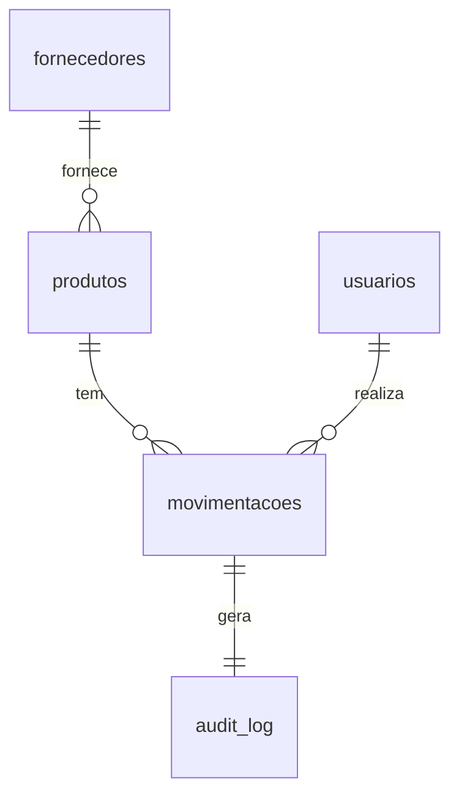

# StockMax — Banco de Dados e Back-End (Node.js + SQL)

Controle de estoque feito somente com **JavaScript (Node.js)** e **SQL (PostgreSQL/Neon)**. Inclui o **site** (HTML gerado no servidor, funciona no celular) e a **API REST** descrita no slide "Endpoints do MVP". O navegador não executa JavaScript e não há arquivos `.html`/`.css`; o visual vem de uma folha de estilo pronta (Pico) carregada por link.

## Estrutura
```
server.js                          Site (rotas HTML) e montagem do app
api.js                             API REST em /api (JSON, token Bearer)
services.js                        Regras de aplicação: validação (DTO) e acesso ao banco
views.js                           Funções que geram o HTML
db/migrations/001_modelo_inicial.sql      5 tabelas, ENUMs, CHECK, FKs e índices
db/migrations/002_regras_e_auditoria.sql  registrar_movimentacao(), triggers imutáveis, view de alertas
db/migrate.js · db/seed.js · db/pool.js   Migrations versionadas, dados de demo (opcional), conexão
tests/banco.test.js                Testes de CRUD, concorrência e violação de constraints
```

## Modelo de dados (5 tabelas)

Colunas conforme o slide: `usuarios` (id UUID, nome, email UQ, senha_hash, permissao ENUM), `fornecedores` (id, razao_social, cnpj UQ, telefone, status), `produtos` (id, fornecedor_id FK, sku UQ, preco_venda, estoque_min, + nome, categoria, preco_custo, codigo_barras, estoque_atual, ativo), `movimentacoes` (id, produto_id FK, usuario_id FK, tipo ENUM E/S, quantidade, + motivo, created_at) e `audit_log` (id BIGSERIAL, movimentacao_id, saldo_anterior, saldo_novo, created_at).

## Travas na base (defesa em profundidade)
| Mecanismo | Implementação | Garante |
|---|---|---|
| PK e FK | `PRIMARY KEY` / `REFERENCES` | Integridade (sem registros órfãos) |
| CHECK | `estoque_atual >= 0`, `quantidade >= 0`, `saldo_novo >= 0`, motivo não vazio | Zero saldo negativo |
| Índice único | `CREATE UNIQUE INDEX idx_sku` | Unicidade de SKU |
| Índice B-Tree | `CREATE INDEX idx_cod_barras` (e `idx_produtos_baixo`, parcial) | Busca em O(log n) |
| Função + trava de linha | `registrar_movimentacao()` com `FOR UPDATE` | Saldo, movimentação e Audit_Log na **mesma transação**, seguro em acessos concorrentes |
| Triggers | `BEFORE UPDATE OR DELETE` em `movimentacoes` e `audit_log` | Histórico imutável |

## API REST (prefixo `/api`)
Autenticação: `POST /api/auth/login` com `{"email","senha"}` devolve `{"token","usuario"}`; envie `Authorization: Bearer <token>` nas demais rotas. Erros: `{"erro":"mensagem"}`.

| Método e rota | Perfil | Descrição | Status |
|---|---|---|---|
| `POST /api/produtos` | admin | Cadastra item (SKU único, categoria, custo, estoque mínimo) | 201 · 400 · 409 |
| `GET /api/produtos` | todos | Lista paginada. Filtros: `q`, `categoria`, `fornecedor`, `status` (ativo/inativo/todos), `pagina`, `limite` | 200 |
| `PUT /api/produtos/:id` · `DELETE /api/produtos/:id` | admin | Atualiza · desativa (soft delete) | 200 · 404 |
| `POST /api/movimentacoes` | todos | Entrada/saída em transação única com trava de saldo | 201 · 404 · 422 |
| `GET /api/movimentacoes` | todos | Histórico com saldo anterior/novo. Filtros: `tipo`, `produto`, `usuario`, `de`, `ate` | 200 |
| `GET /api/relatorios/estoque-baixo` | todos | Alertas críticos (view `v_estoque_baixo`) | 200 |

Exemplo:
```bash
curl -X POST $URL/api/movimentacoes -H "Authorization: Bearer $TOKEN" -H "Content-Type: application/json" \
  -d '{"produto_id":"<uuid>","tipo":"S","quantidade":3,"motivo":"Venda pedido 1042"}'
# 201 {"movimentacao_id":"...","saldo_anterior":10,"saldo_novo":7}
```

## Como rodar
Requisitos: Node.js 18+ e PostgreSQL (Neon: botão **Connect**, string *pooled*).
```bash
npm install
cp .env.example .env     # preencha DATABASE_URL e SECRET_KEY
npm run migrate          # aplica as migrations (o servidor também aplica ao iniciar)
npm start                # http://localhost:3000
npm run seed             # opcional: dados de demonstração
```
A primeira conta criada vira **admin**; as seguintes, **operador**. O banco começa zerado.

## Testes (Fase 01 do roadmap)
Crie um banco ou *branch* separado no Neon, coloque a string em `DATABASE_URL_TEST` e rode `npm test`. Cobre CRUD, SKU duplicado, saldo negativo (violação proposital de CHECK), saída maior que o saldo, Audit_Log, **concorrência** (5 saídas simultâneas) e imutabilidade do histórico.

## Vercel
Envie ao GitHub com `server.js` e `package.json` na raiz, importe em vercel.com/new e defina em *Settings → Environment Variables*: `DATABASE_URL`, `SECRET_KEY` e `COOKIE_SECURE=1`. As migrations rodam no primeiro acesso. Nunca envie o `.env` ao GitHub.

## Se a Vercel mostrar erro ou "unavailable"
1. Abra `https://SEU-PROJETO.vercel.app/saude`. Se mostrar `"ok": true`, o app está no ar; confira se `DATABASE_URL_definida` é `true`.
2. Em *Settings → Environment Variables*, confirme `DATABASE_URL`, `SECRET_KEY` e `COOKIE_SECURE`, depois faça *Redeploy*.
3. Veja *Deployments → o deploy → Logs* (aba *Runtime Logs*) para a mensagem exata.
4. `server.js` e `package.json` precisam estar na **raiz** do repositório (ou ajuste *Root Directory*).
